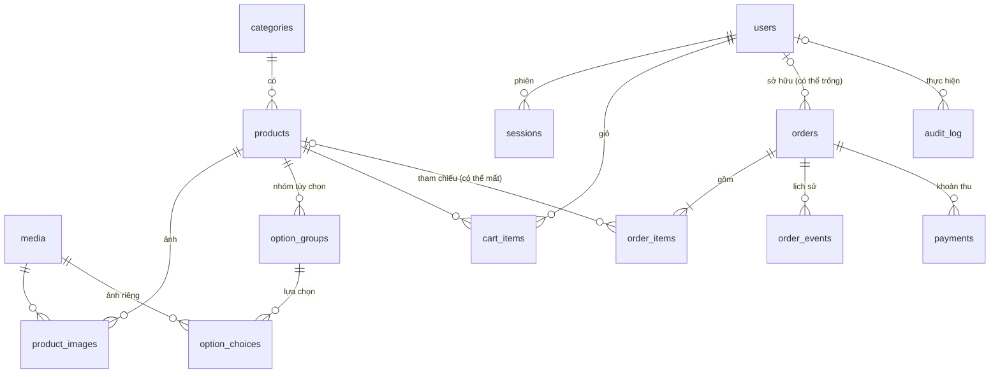

# 03. Mô hình dữ liệu

Lược đồ chính thức là các file SQL trong [sql/](sql/) (đã chạy thử trên SQLite 3.54: tạo bảng, nạp seed, kiểm tra khóa ngoại, thử các ràng buộc). Tài liệu này giải thích ý nghĩa; nếu có khác biệt thì **file SQL là đúng**.

## 1. Quy ước

- Tiền: `INTEGER` VND. Thời gian: `INTEGER` epoch giây UTC (mặc định `unixepoch()`).
- Khóa ngoài lộ ra ngoài (`users.id`, `orders.id`): `TEXT` là `nanoid(21)`. Bảng còn lại: số tự tăng.
- `products.id` **giữ nguyên số** từ dữ liệu cũ (1 đến 15) vì giỏ hàng KV đang tham chiếu theo id.
- D1 bật khóa ngoài mặc định. `ON DELETE CASCADE` cho dữ liệu con thuần túy; `ON DELETE SET NULL` khi cần giữ lịch sử (đơn hàng không được mất khi xóa sản phẩm hay người dùng).
- SĐT lưu dạng chuẩn `0xxxxxxxxx`; email chữ thường.

## 2. Sơ đồ quan hệ



## 3. Các bảng

### 3.1 Cấu hình: `settings`

Khóa → JSON. Khởi tạo bởi `seed-catalog.sql`. Đọc công khai một phần (xem [04-api-spec.md](04-api-spec.md) mục 4).

| key | Dạng value | Mặc định |
|---|---|---|
| `showroom` | `{ name, address, phone }` | Speed Showroom, "Số nhà 36, đường Z115, phường Phan Đình Phùng, tỉnh Thái Nguyên", `0336436536` |
| `pickup` | `{ open, close, days, slotMinutes, capacity, minNoticeHours, maxAdvanceDays }` | `08:00`, `18:00`, `[0..6]` (0 = Chủ nhật), 60, 5, 2, 30 |
| `orders` | `{ pendingHoldHours }` | 48 |

### 3.2 Danh mục: `categories`, `products`, `media`, `product_images`

- `products.stock`: số nguyên ≥ 0 là xe có sẵn; `NULL` là làm theo đơn (xem BR-STK trong [01-requirements.md](01-requirements.md)). `CHECK (stock IS NULL OR stock >= 0)` là **chốt chặn chống bán quá số lượng**.
- `products.lead_time_days`: thời gian chờ dự kiến cho xe đặt trước, chỉ để hiển thị.
- `products.active`: 0 là ẩn khỏi cửa hàng.
- `products.spec`: thông số ngắn ngăn cách bởi ` · ` (ví dụ `125cc · Tay ga · 2 chỗ`); trang chi tiết tách ra để hiển thị bảng.
- `media`: mỗi ảnh một dòng. `url` là đường dẫn công khai. `r2_key` có giá trị với ảnh tải lên (phục vụ qua `/media/*`); **`NULL` với ảnh tĩnh đi kèm bản build** (67 ảnh SVG minh họa ban đầu).
- `product_images`: thư viện ảnh của sản phẩm; **ảnh chính là ảnh có `sort` nhỏ nhất**. Khóa chính `(product_id, media_id)` nên một ảnh không gắn hai lần vào cùng một sản phẩm.

### 3.3 Tùy chọn: `option_groups`, `option_choices`

- `option_groups.key` và `option_choices.key` là id **ổn định** dùng trong giỏ hàng (`picks`, id dòng giỏ hàng). **Không đổi `key` sau khi đã có đơn hoặc giỏ dùng**; đổi tên hiển thị thì sửa `name`.
- `type = 'color'`: lựa chọn có `hex` và thường có `media_id` (ảnh xe theo màu). `type = 'choice'`: lựa chọn thường (phiên bản, gói).
- `option_choices.price_delta ≥ 0`: phụ phí cộng vào đơn giá. Lựa chọn đầu tiên (theo `sort`) là mặc định và thường có phụ phí 0.
- `option_choices.media_id`: **ảnh riêng của lựa chọn**. Thiếu thì giao diện dùng ảnh chính của sản phẩm. `ON DELETE SET NULL` để xóa ảnh không làm mất lựa chọn.
- Mỗi sản phẩm nên có ít nhất 1 lựa chọn trong mỗi nhóm (nhóm rỗng bị loại ở API admin).

### 3.4 Người dùng: `users`, `sessions`

- `users.phone` duy nhất và là định danh đăng nhập chính. `email` duy nhất nhưng có thể trống (nhiều dòng `NULL` được phép).
- `password_hash` dạng `pbkdf2$sha256$<số vòng>$<muối base64>$<hash base64>` (xem [05-security.md](05-security.md) mục 3).
- `sessions.id` là **SHA-256 (hex) của token** trong cookie. Token gốc không bao giờ lưu.
- `disabled = 1`: không đăng nhập được; xóa hết `sessions` của người đó khi khóa.

### 3.5 Giỏ hàng: `cart_items`

Chỉ dành cho người đã đăng nhập. Khách vãng lai dùng KV (khóa `cart:<cartId>`, định dạng giữ nguyên hiện tại, xem [04-api-spec.md](04-api-spec.md) mục 11).

- `line_key`: id dòng giỏ hàng, `"<productId>~<nhóm>.<lựa chọn>~..."` với các cặp **sắp theo tên nhóm**. Cùng `(user_id, line_key)` là cùng một dòng, nên thêm trùng thì cộng `qty`.
- `picks`: JSON `{ "mau": "cam", "ban": "cao-cap" }`.

### 3.6 Đơn hàng: `orders`, `order_items`, `order_events`, `payments`

`orders`:

| Cột | Ý nghĩa |
|---|---|
| `code` | Mã đơn hiển thị `SS-XXXXX-XXXXX`, duy nhất |
| `user_id` | Chủ đơn nếu đã gắn tài khoản; `NULL` với khách chưa có tài khoản |
| `status` | `pending`, `confirmed`, `ready`, `completed`, `cancelled`, `expired` |
| `contact_*` | Bản chụp thông tin liên hệ lúc đặt. Địa chỉ và ghi chú có thể trống |
| `internal_note` | Ghi chú của nhân viên. **Không bao giờ** trả cho khách hay tra cứu công khai |
| `pickup_at` | Giờ bắt đầu khung hẹn (epoch giây) |
| `subtotal`, `total` | Hiện bằng nhau (không phí vận chuyển). Giữ hai cột để mở rộng sau |
| `paid_total` | Tổng các dòng `payments`. `CHECK (paid_total <= total)` chặn thu thừa |
| `hold_expires_at` | Hạn giữ xe nếu còn `pending` |
| `last_token` | Token ngẫu nhiên của lần đổi trạng thái gần nhất, dùng để chống đua (mục 6.2) |

`order_items` là **bản chụp tại thời điểm mua**: `name`, `image` (ảnh theo màu đã chọn), `unit_price` (đã cộng phụ phí), `options` (JSON). `product_id` chỉ để tham chiếu và kho (`SET NULL` nếu sản phẩm bị xóa).

`options` trong `order_items` có dạng:

```json
[
  { "group": "Màu sắc",  "choice": "Cam", "hex": "#ff7a1a", "price": 0 },
  { "group": "Phiên bản", "choice": "Cao cấp (đèn LED, khóa thông minh)", "price": 3000000 }
]
```

`order_events`: mỗi lần đổi trạng thái một dòng. Đây là nguồn của dòng thời gian khi khách tra cứu. `actor_id` rỗng nghĩa là khách hoặc hệ thống.

`payments`: một dòng cho mỗi khoản đã thu. `orders.paid_total` luôn bằng tổng `amount` (cập nhật trong cùng `batch`).

`audit_log`: `action` theo dạng `<đối tượng>.<hành động>`, ví dụ `product.update`, `order.status`, `order.payment`, `user.disable`, `settings.update`. `detail` là JSON trước/sau.

## 4. Tính giá

```
đơn giá dòng = products.base_price + Σ option_choices.price_delta  (mỗi nhóm đúng 1 lựa chọn)
thành tiền dòng = đơn giá dòng × qty
orders.subtotal = Σ thành tiền các dòng ;  orders.total = orders.subtotal
```

`normalizePicks(product, picks)`: với mỗi nhóm, nếu `picks[group]` là lựa chọn hợp lệ thì giữ, không thì lấy lựa chọn đầu tiên (theo `sort`). Hàm này dùng chung cho giỏ hàng và đặt hàng để giá luôn khớp giữa hai nơi. **Khi đặt hàng**, lựa chọn bị loại bỏ vì không hợp lệ nghĩa là giỏ cũ: trả `option_invalid` thay vì lặng lẽ đổi (xem BR-PRC-2).

## 5. Nguồn dữ liệu ban đầu

`sql/seed-catalog.sql` được **sinh** từ `apps/api/seed.sql` cũ bằng [`sql/convert-legacy-seed.sql`](sql/convert-legacy-seed.sql) (dùng `json_each` của SQLite để tách cột JSON `options` thành bảng). Quy ước chuyển đổi:

| Dữ liệu cũ | Dữ liệu mới |
|---|---|
| `products.category` | `categories.slug` (5 danh mục) |
| `products.price` | `products.base_price` |
| `products.image` (`/vehicles/xe-may-pho-rider.svg`) | `media` (ảnh tĩnh, `r2_key` NULL) + `product_images` (sort 0); `slug` = tên file bỏ đuôi (`xe-may-pho-rider`) |
| `options[].id`, `.name`, `.type` | `option_groups.key`, `.name`, `.type`; thứ tự mảng là `sort` |
| `options[].choices[].id/name/price/hex` | `option_choices.key/name/price_delta/hex` |
| Ảnh theo màu `/vehicles/xe-may-pho-rider--cam.svg` | `media` mới + `option_choices.media_id` (52 lựa chọn màu) |

Số liệu kiểm tra sau chuyển đổi: 5 danh mục, 15 sản phẩm, 67 ảnh (15 chính + 52 theo màu, khớp 67 file trong `apps/web/public/vehicles`), 45 nhóm, 112 lựa chọn, kiểm tra khóa ngoại sạch.

Sau khi có G1, **xóa** `apps/api/schema.sql`, `apps/api/seed.sql` cũ và cột JSON; `make db-init` đổi sang áp migration và nạp seed mới. `scripts/gen-vehicle-art.mjs` đọc định dạng seed **cũ**; nếu cần sinh lại ảnh minh họa sau khi xóa seed cũ thì chỉ sinh ảnh gốc (không truyền seed).

## 6. Thuật toán then chốt

### 6.1 Tạo đơn (`services/orders.createOrder`)

Đầu vào: thông tin liên hệ, ghi chú, ngày và giờ nhận, nguồn giỏ hàng (user hoặc `cartId`), người dùng hiện tại (nếu có).

```text
1. Chuẩn hóa: phone = normalizePhone(...), email = lower(...); sai thì validation_failed.
2. Đọc giỏ (user → cart_items ở D1, khách → KV theo x-cart-id). Rỗng → cart_empty (400).
3. Nạp sản phẩm của các dòng (id IN ...) cùng nhóm/lựa chọn. Với mỗi dòng:
     - sản phẩm không tồn tại hoặc active = 0 → product_unavailable (409)
     - mọi pick phải hợp lệ → nếu không: option_invalid (409)
     - đơn giá = base_price + Σ price_delta ; thành tiền = đơn giá × qty
     - ảnh = ảnh của lựa chọn màu (media.url) hoặc ảnh chính
     - nếu stock != NULL và stock < tổng qty của sản phẩm trong giỏ → out_of_stock (409, nêu productId)
4. Kiểm tra khung giờ nhận (slots.isAvailable): sai → slot_unavailable (409).
5. Tính subtotal = total, hold_expires_at = now + pendingHoldHours×3600.
6. Chủ đơn: user_id = người đang đăng nhập; nếu không có thì
      user_id = (SELECT id FROM users WHERE phone = :phone)  -- có thể NULL
7. Sinh id (nanoid) và code. Chạy MỘT db.batch():
     a. INSERT INTO orders (...)
     b. INSERT INTO order_items (...)    -- mỗi dòng một câu
     c. INSERT INTO order_events (order_id, status) VALUES (:id, 'pending')
     d. UPDATE products SET stock = stock - :qty, updated_at = :now
          WHERE id = :productId AND stock IS NOT NULL      -- mỗi sản phẩm có kho, một câu
     e. (giỏ tài khoản) DELETE FROM cart_items WHERE user_id = :user
   - Nếu (d) làm stock < 0 → CHECK thất bại → TOÀN BỘ batch bị hoàn tác → ném out_of_stock.
   - Nếu (a) vi phạm UNIQUE(code) → sinh code mới và thử lại, tối đa 5 lần, rồi mới báo lỗi.
8. Sau khi batch thành công: nếu là giỏ KV thì xóa khóa KV. (KV không nằm trong giao dịch;
   nếu xóa KV thất bại cũng không sao vì đơn đã tạo, giỏ cũ sẽ tự hết hạn.)
9. Trả về đơn (đầy đủ, vì người đặt vừa tự nhập thông tin).
```

Lưu ý: bước 3 đọc kho và bước 7d trừ kho không cùng giao dịch; **chốt chặn thật là `CHECK`** ở 7d. Bước 3 chỉ để báo lỗi sớm và rõ ràng.

### 6.2 Đổi trạng thái đơn (mẫu chung, có chống đua)

Mọi lần đổi trạng thái (xác nhận, sẵn sàng, giao xe, hủy, hết hạn) đi theo **một mẫu**. Mẫu này an toàn khi hai bên cùng đổi một đơn (admin bấm hai lần, admin và cron cùng lúc, khách hủy trong lúc admin xác nhận):

```text
token = nanoid()            -- mới cho MỖI lần gọi
db.batch([
  -- (1) Chuyển trạng thái. Chỉ khớp nếu đơn VẪN đang ở trạng thái cũ. Ghi token của lần gọi này.
  UPDATE orders SET status = :new, last_token = :token, updated_at = :now
     WHERE id = :id AND status = :old [AND paid_total = total]     -- điều kiện thêm cho :new = 'completed'
  -- (2) Ghi lịch sử, chỉ khi (1) thắng, tức đơn đang mang đúng token của MÌNH
  INSERT INTO order_events (order_id, status, note, actor_id)
     SELECT :id, :new, :note, :actor
     WHERE EXISTS (SELECT 1 FROM orders WHERE id = :id AND last_token = :token)
  -- (3) Chỉ khi hủy hoặc hết hạn: trả kho, mỗi dòng order_items có product_id một câu, cùng điều kiện token
  UPDATE products SET stock = stock + :qty
     WHERE id = :productId AND stock IS NOT NULL
       AND EXISTS (SELECT 1 FROM orders WHERE id = :id AND last_token = :token)
])
-- Sau batch: đọc lại đơn; nếu orders.last_token != token thì lần gọi này THUA → ném conflict
-- (invalid_transition: "Đơn đã được xử lý bởi người khác").
```

Vì sao dùng token riêng thay vì điều kiện `status = :new`: nếu hai lần hủy cùng đổi sang `cancelled`, điều kiện `status = 'cancelled'` đúng với **cả hai**, kho sẽ bị cộng hai lần. Token thì chỉ khớp với lần đã thật sự thắng ở bước (1).

Bảo vệ thêm: `UNIQUE (order_id, status)` trên `order_events` (mỗi trạng thái xảy ra tối đa một lần trong đời một đơn, vì vòng đời là một chiều). Nếu mã lập trình sai khiến ghi trùng sự kiện, cả batch bị hoàn tác thay vì ghi trùng lặng lẽ.

Đã chạy thử mô phỏng bằng SQLite: hủy hai lần liên tiếp với hai token khác nhau thì kho chỉ được cộng một lần, chỉ có một sự kiện, `last_token` giữ token thắng. **Cần có test tích hợp tương ứng trên D1 giả lập** (xem [07-implementation-plan.md](07-implementation-plan.md) G2): hủy đồng thời hai lần chỉ cộng kho một lần; hủy rồi hết hạn không cộng lại.

`:old` lấy từ trạng thái đọc ra ở mã **sau khi** đã kiểm tra `old → new` hợp lệ theo bảng BR-ORD-1. Cron hết hạn dùng đúng mẫu này với `:old = 'pending'`, `:new = 'expired'`, `actor = NULL`.

### 6.3 Đổi trạng thái không ảnh hưởng kho

Dùng cùng mẫu 6.2 nhưng bỏ bước (3). Với `ready → completed`, `UPDATE` ở (1) có thêm `AND paid_total = total` nên chưa thu đủ thì không khớp dòng nào, `last_token` không đổi và lần gọi báo lỗi `payment_incomplete` (409).

### 6.4 Ghi khoản thu

Điều kiện ở mã (trước khi chạy batch): đơn không ở trạng thái `cancelled` hoặc `expired`; `amount > 0`.

```text
db.batch([
  INSERT INTO payments (order_id, amount, method, note, received_by) VALUES (:id, :amount, :method, :note, :admin),
  UPDATE orders SET paid_total = paid_total + :amount, updated_at = :now WHERE id = :id
])
-- Thu quá total → CHECK (paid_total <= total) thất bại → cả batch hoàn tác → ném overpay (409).
```

### 6.5 Khung giờ nhận còn trống (`services/slots`)

Đầu vào: khoảng ngày `from`, `to` (tối đa 14 ngày một lần gọi), cấu hình `pickup`, thời điểm hiện tại.

```text
với mỗi ngày d trong [from, to] có (thứ của d) ∈ days:
  với mỗi khung bắt đầu t từ open, cách nhau slotMinutes, sao cho t + slotMinutes ≤ close:
     startsAt = epoch(d, t, +07:00)
     hợp lệ nếu: startsAt ≥ now + minNoticeHours×3600  và  startsAt ≤ now + maxAdvanceDays×86400
     đã đặt = COUNT(*) FROM orders WHERE pickup_at = startsAt AND status IN ('pending','confirmed','ready')
     còn lại = capacity − đã đặt ; khả dụng nếu còn lại > 0
```

Với cấu hình mặc định (8:00 đến 18:00, 60 phút) có 10 khung mỗi ngày, khung cuối bắt đầu lúc 17:00. Đếm đã đặt nên gom một truy vấn `GROUP BY pickup_at` cho cả khoảng ngày. Khi tạo đơn, kiểm tra lại khung (bước 4 của 6.1); hai người đặt cùng khung cuối cùng cùng lúc có thể vượt `capacity` đúng 1 đơn, **chấp nhận được** vì chỉ là lịch hẹn, không phải tài nguyên khan hiếm.

### 6.6 Gắn đơn theo SĐT (`services/claim`)

```text
Khi đăng ký thành công (trong cùng batch tạo user):
  UPDATE orders SET user_id = :userId WHERE contact_phone = :phone AND user_id IS NULL
Trả về số đơn đã gắn (db meta.changes) cho frontend hiển thị "Tìm thấy N đơn".
```

Không có bước xác minh (D3). Tạo đơn sau này cũng áp dụng quy tắc ở bước 6 của 6.1.

### 6.7 Gộp giỏ khách vào giỏ tài khoản

```text
Khi đăng nhập/đăng ký có header x-cart-id hợp lệ:
  đọc giỏ KV; với mỗi dòng: INSERT INTO cart_items (user_id, product_id, line_key, picks, qty)
     VALUES (...) ON CONFLICT (user_id, line_key) DO UPDATE SET qty = MIN(99, qty + excluded.qty)
  xóa khóa KV sau khi ghi D1 thành công.
```

## 7. Truy vấn thường dùng và chỉ mục

| Nhu cầu | Truy vấn | Chỉ mục |
|---|---|---|
| Tra cứu đơn theo mã | `WHERE code = ?` | `UNIQUE(code)` |
| Đơn của tôi | `WHERE user_id = ? ORDER BY created_at DESC` | `idx_orders_user` |
| Gắn đơn theo SĐT, tìm đơn theo SĐT (admin) | `WHERE contact_phone = ?` | `idx_orders_phone` |
| Bảng đơn theo trạng thái | `WHERE status = ? ORDER BY created_at DESC` | `idx_orders_status` |
| Lịch nhận xe | `WHERE pickup_at BETWEEN ? AND ?` | `idx_orders_pickup` |
| Cron hết hạn | `WHERE status = 'pending' AND hold_expires_at < ?` | `idx_orders_hold` |
| Đọc phiên | `WHERE id = ?` (khóa chính) | PK |
| Dọn phiên | `WHERE expires_at < ?` | `idx_sessions_expires` |
| Đếm khung giờ | `WHERE pickup_at = ? AND status IN (...)` | `idx_orders_pickup` |

Quy mô dự kiến nhỏ (vài nghìn đơn mỗi năm) nên các chỉ mục trên là đủ; chưa cần phân trang con trỏ, dùng `LIMIT/OFFSET`.
